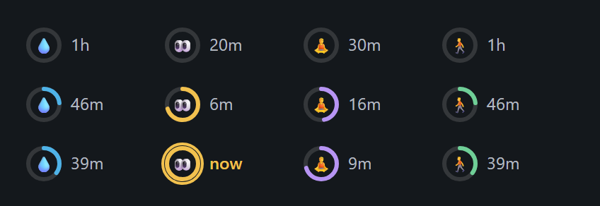
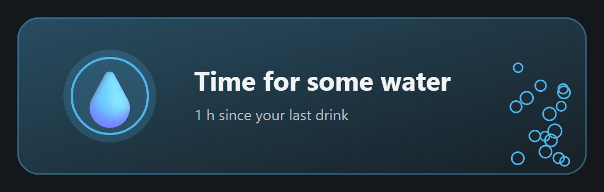

# breaks

**Healthy-work cooldowns for Claude Code.** Water, eyes, stretch, walk, medicine, and anything you add, charging quietly above your prompt like skill cooldowns in a game.



## Why

Working in Claude Code is easy to lose track of time in. You hand over a task, it works, you review, you hand over the next one, and suddenly it is three hours later. You have not had a drink, stood up or looked away from the screen since you started.

`breaks` is the smallest thing that fixes that. It sits in a row above the prompt and shows a few cooldowns charging while you work. When one is full you get a friendly pop-up that says what to do, why it matters, and a fun fact. Press its button (Drank, Looked away, Stretched, Walked) and it starts charging again. It never interrupts a reply, and it does not ask for anything while you are typing.

No timers to set, no separate app to keep open, and no one else to notice. Install it once and get on with your work.



## What you get

- **Cooldowns above the prompt.** A ring fills around each icon, with the time left beside it (desktop app), or `💧 ◔ 31m` text (terminal). One that is due lights up, says `now`, and offers a button to mark it done and start it charging again.
- **A pop-up that explains.** Why this break matters, in a sentence, and a random fun fact. A large animated banner on the desktop, a bordered card in the terminal. It lands between turns, not in the middle of a reply.
- **Sensible defaults, all adjustable.** Intervals come from published guidance (see [Where the defaults come from](#where-the-defaults-come-from)).
- **Your own reminders.** Add a snack, a plant to water or a prompt to breathe, with your own emoji and message.
- **A settings pane.** `/breaks` opens it: switch reminders on or off, change how often, add, delete.
- **It notices when you step away.** A prompt after a long silence counts as the break for eyes, stretch and walk.
- **Works in the terminal and the desktop app**, and on its own. No other mod needed.

## Install

In a terminal session:

```
/plugin install breaks --marketplace VladGirboan/claude-breaks
```

Answer `y` to add the marketplace, then choose a scope. Needs Claude Code 2.1.287 or later (mods are on by default).

To try it from a folder instead, run `claude --plugin-dir <path to this folder>`.

## Staying up to date

New versions land on this repository's `main` branch. A mod cannot reach the network by itself, so there are three ways to hear about one:

- **Let Claude Code update it.** Run `/plugin`, open **Marketplaces**, pick `breaks-marketplace` and turn on auto-update. Then run `/reload-plugins` after a session start tells you it changed.
- **Let breaks look.** `/breaks update on` makes it check once a week, when a session starts, and tell you once when a newer version is out. It reads one file, `.claude-plugin/plugin.json`, through Claude Code's web fetch tool, so Claude Code asks permission the first time. Allow `raw.githubusercontent.com` and it stays quiet after that. It is off until you switch it on, and `/breaks update` (or **Check now** in the settings) looks whenever you ask.
- **Pull it yourself.** If you cloned the repository and run it with `--plugin-dir`, `git pull` in that folder.

## Try it

```
/breaks test      a sample pop-up, so you can see what it looks like
/breaks           the settings
/breaks status    what is charging, and how long is left
```

## Where the defaults come from

| Reminder | Every | Why this number |
|---|---|---|
| 👀 **Eyes** | 20 min | The American Optometric Association's [20-20-20 rule](https://www.aoa.org/healthy-eyes/eye-and-vision-conditions/computer-vision-syndrome): every 20 minutes, look at something 20 feet away for 20 seconds. |
| 🧘 **Stretch** | 30 min | Ergonomics guidance counts a break of [under two minutes](https://www.umaryland.edu/ehs/occupational-safety-and-health/ergonomics) as a micro-break, with a brief break every 30 to 60 minutes. Thirty sits at the short end. |
| 💧 **Water** | 60 min | A glass an hour over a working day is about 8 cups, which covers most of the 9 to 13 cups of fluid a day that [Cleveland Clinic](https://health.clevelandclinic.org/how-much-water-do-you-need-daily) gives as a starting point. |
| 🚶 **Walk** | 60 min | Studies of breaking up sitting used 3 to 5 minutes of light walking every 30 minutes ([Wennberg 2016](https://pmc.ncbi.nlm.nih.gov/articles/PMC4769400); Diaz 2023). Every hour is the practical compromise. |
| 💊 **Medicine** | 8 h, **off** | There is no recommended interval: it is whatever your label or prescriber says. It ships switched off, and 8 hours is only a placeholder. |

A few honest notes on these numbers:

- **They are starting points, not prescriptions.** The evidence for most break schedules is modest. The studies are small, and researchers say the best dose varies from person to person. The 20-20-20 rule is widely recommended, though little research has tested it directly.
- **Twenty minutes for your eyes is frequent.** If it is too much, `/breaks set eyes 30`. Everything is yours to change, and you can turn any reminder off.
- **Your settings are never changed behind your back.** If you already have the mod and want the recommended numbers, `/breaks defaults` sets the built-in reminders to them. It leaves what is on or off, and your own reminders, alone.

## The fun facts

Every fact in the pop-ups was checked against a source before it went in, and the source is named in a comment beside it in [`hooks/templates.ts`](hooks/templates.ts). Where a claim is a small study, the fact says so ("in a small 2016 study of 19 adults"). If you find one that is wrong, please open an issue.

## Your own reminders

Type one line in the settings pane's **Add a reminder** field, or use `/breaks add`:

```
🍎 Snack 90 | Time to eat something
```

That is an emoji, a name, the minutes between reminders, and after a bar the line to show in the pop-up. The emoji and the minutes are optional (it comes every 60 minutes without them). There can be up to 12 reminders. You can switch any of them on or off and delete any of them, built-in ones included. Deleting asks first, and `/breaks restore` brings back built-in ones you deleted.

## Commands

```
/breaks                        open the settings
/breaks status                 what is charging, and how long is left
/breaks done [name]            you took the break: charge it again (every due one if no name)
/breaks snooze [name] [min]    remind me again in 10 minutes, or the minutes given
/breaks pause | resume         hold every timer, then let them run again
/breaks on <name> | off <name>
/breaks set <name> <minutes>   how often a reminder comes
/breaks add <emoji> <name> <minutes> | <message>   a reminder of your own
/breaks delete <name>          remove a reminder
/breaks restore                bring back the built-in reminders you deleted
/breaks defaults               set the built-in reminders to the recommended intervals
/breaks sound on | off         the chime (macOS only)
/breaks update                 look for a newer version on GitHub
/breaks update on | off        look once a week when a session starts
/breaks test                   show a sample pop-up
```

A name is the start of the reminder's name: `/breaks set wat 40` works.

## How it behaves

- **It waits for a good moment.** Nothing pops up while Claude is mid-reply; it waits for the turn to end. The pop-up asks for the keyboard only when your prompt is empty, so it never takes keys from a message you are typing.
- **One pop-up at a time.** Reminders that come due together share one pop-up with a card each.
- **Stepping away counts.** If you send a prompt after 20 minutes of silence, eyes, stretch and walk are treated as taken. Water is not, because being away does not drink for you. Starting a session after a long gap starts every cooldown fresh instead of piling up pop-ups.
- **Shared across sessions.** The cooldowns live in the plugin's store, so marking one done in one session shows in the others, and a reminder does not pop up twice.

## Limits

- **The medicine reminder is a nudge, not advice.** It reminds you to look at your label or your prescriber's instructions. It knows nothing about your medicine, your dose or a missed one.
- **It only reminds you while Claude Code is running.** Close it, or let the computer sleep, and the clocks keep going but nothing can tell you. When you come back, anything that came due shows as due.
- **The pop-up is only seen inside the app.** If you are in another window you will miss it. On a terminal too narrow for a pane (under about 144 columns, when it opens by itself) the pop-up becomes one long toast with the same words.
- **Update checks are opt-in.** Looking costs a web request that Claude Code has to ask your permission for, so breaks does not do it behind your back.
- **The chime plays on macOS only.** Claude Code gives a mod no sound player elsewhere, so on Windows and Linux the pop-up and the lit icon are the signal. Turn the chime off in the settings if you like.
- **Two sessions saving in the same instant** can lose one change. It is a small file of settings and times, and the next tick puts it right.
- **The pictures above are drawn by the mod's own code, not screenshots of Claude Code.**

## Files

```
.claude-plugin/plugin.json        the manifest
.claude-plugin/marketplace.json   makes this repository installable with /plugin install
hooks/hooks.json                  names the module
hooks/register.tsx                wiring: events, the timer, the store, the pop-up
hooks/reminders.ts                the reminders and every rule that charges them (pure)
hooks/templates.ts                the built-in reminders: wording, why each matters, facts, default intervals
hooks/version.ts                  this version, and how a newer one is recognized
hooks/command.ts                  what /breaks does (pure)
hooks/band.tsx                    the row above the prompt
hooks/alert.tsx                   the pop-up card, in the terminal and on the desktop
hooks/settings.tsx                the settings pane
hooks/art.ts                      the desktop's ring icons
hooks/hero.ts                     the desktop pop-up's large animated banner
types/index.d.ts                  the state the mod keeps, and its shape in the store
assets/chime.wav                  the chime
docs/                             the pictures in this README
tests/                            run with: claude plugin test .
```

A hooks module's `$` can only be passed to functions declared in the same file, so everything that touches the engine is in `register.tsx`. The rest is plain functions that take and return data, and is tested without a session.

## Develop

```
claude plugin validate .     # reads the manifest, the marketplace file and the hooks module
claude plugin test .         # 41 tests, with a mocked clock and store
```

To release a new version, change `version` in `.claude-plugin/plugin.json` and `VERSION` in `hooks/version.ts` together, then push to `main`. People who switched on the weekly look are told the next time a session starts.

To add a built-in reminder, add an entry to `TEMPLATES` in `hooks/templates.ts`, with its wording, why it matters, a few facts and the source for each. A person who already has the mod is given it once, the next time it starts. Keep the facts plain and true, and never turn a health reminder into advice.

## Sources

- [American Optometric Association: computer vision syndrome and the 20-20-20 rule](https://www.aoa.org/healthy-eyes/eye-and-vision-conditions/computer-vision-syndrome)
- [American Academy of Ophthalmology: blinking at a screen](https://www.aao.org/eye-health/tips-prevention/computer-usage)
- [University of Maryland Environmental Safety: ergonomics and micro-breaks](https://www.umaryland.edu/ehs/occupational-safety-and-health/ergonomics)
- [USGS Water Science School: the water in you](https://www.usgs.gov/special-topics/water-science-school/science/water-you-water-and-human-body)
- [Cleveland Clinic: how much water you need](https://health.clevelandclinic.org/how-much-water-do-you-need-daily)
- [Hydration status in older adults (thirst and age)](https://pmc.ncbi.nlm.nih.gov/articles/PMC10255140/)
- [Wennberg et al., BMJ Open 2016: breaking up prolonged sitting, fatigue and cognition](https://pmc.ncbi.nlm.nih.gov/articles/PMC4769400)
- Diaz et al., *Medicine & Science in Sports & Exercise*, 2023: 5-minute walks every 30 minutes of sitting (read through news coverage, not the paper itself)
- [Oppezzo and Schwartz, Stanford: walking and creative thinking](https://ed.stanford.edu/news/study-finds-walking-boosts-creativity)
- Marshall et al., *American Journal of Preventive Medicine*, 2009: about 100 steps a minute at a moderate pace (read through [news coverage](https://www.nbcnews.com/news/amp/wbna29737029))
- [MedlinePlus: a medicine label's advice on timing, missed doses and double doses](https://medlineplus.gov/druginfo/meds/a692051.html)
- [NHS: forgotten doses, alarms and asking a pharmacist](https://www.nhs.uk/medicines/finasteride/how-and-when-to-take-finasteride/)

## License

MIT
